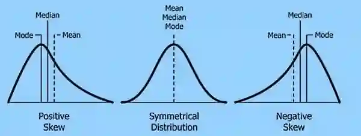

## Skewness

* In statistics, skewness describes the lack of symmetry of a data distribution

* There are 3 types of skewness

### Method 1: The central tendency comparison

* Positive

  * Skew: Mode \< Median\< Mean

* Symmetrical

  * Skew: Mean = Median = Mode

* Negative

  * Skew: Mean\< Median \< Mode

    

### Method 2: Using the quartile distance formula

* Symmetrical: $Q_3 - Q_2$ = $Q_2 - Q_1$

* Positive skew: $Q_3 - Q_2$ \> $Q_2 - Q_1$

* Negative skew: $Q_1 - Q_2$ \> $Q_2 - Q_3$

### Method 3: Pearson’s coefficient of skewness formula

* skewness = $\frac{3(Mean-Median)}{Standard Deviation}$

* If the result is \>0: positive skew

* If the result is \<0: negative skew

* If the result is 0: symmetrical

### Types of Skewness using everyday examples:

* Right (Positive) Skew:

  * The long tail points to the right

  * Most values cluster on the left

  * mean is greater than the median

  * *Example:* In a graph of people's incomes, most regular workers form at the left side of the chart. Because billionaires earn such massive amounts, they stretch the chart far to the right, creating a long, thin tail

* Left (Negative) Skew:

  * The long tail points to the left

  * Most values cluster on the right

  * Mean is less than the median

  * Example: Retirement age, where a large group retires to an old age, but a few people pass away younger, pulling the tail left

### Exam Question:

A distribution is positively skewed.

State the relationship between the mean, median and mode.

**Answer:**

Mode\<Median\<Mean