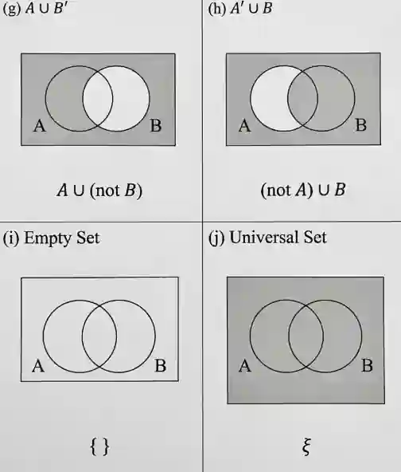

## Venn diagrams

### Notation

* Intersection **$(A \cap B$):** Both A **AND** B occur (the overlapping middle region).

* Union **$(A \cup B)$:** Either A **OR** B **OR** both occur (everything inside both circles combined).

* Complement **$(A^{\prime })$:** Not A (everything outside A).

### Symbols

* $\emptyset \rightarrow$ This is an empty set
* $\mathcal{E}\rightarrow$ Universal Set
  * It represents the entire collection of all possible elements
* Standard set notation:
  * A= \{1,2,3,4,5\}

  * You use curly brackets to show the values inside a particular set. Inside the curly brackets, you should only write the data values

### Example practice

