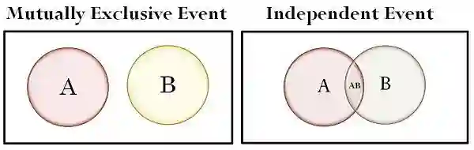

## Mutually exclusive vs independent conditions

### Mutually exclusive

* Two events are mutually exclusive if they cannot happen at the same time. If event ***A*** happens, it completely blocks event ***B*** from happening, and vice versa. There is zero overlap between them.

  * $P(A \cap B) = 0$

  * $P(A \cup B) = P(A) + P(B)$ (You do not need to subtract as they don’t overlap)

  * Example: If P(A)= Linn going to school and P(B)= Linn skipping school, they are mutually exclusive because both cannot occur at the same time

### Independent event

* Two events are independent if the occurrence of one event has absolutely no effect on the probability of the other event occurring. They can absolutely happen at the same time; it is just that one doesn't care about the other

  * $P(A \cap B) = P(A) \times P(B)$

**Example question:**

A card is drawn from a standard deck of 52 cards.

* Event A: Drawing a King (there are 4 kings in the entire deck)

* Event B: Drawing a Red card (Heart or Diamond). (There are 26 cards)

* Find whether these two are independent

**Answer:**

* $P(A)=\frac{4}{52}=\frac{1}{13}$ & $P(B)=\frac{26}{52}=\frac{1}{2}$

* $P(A\cap B)=\frac{2}{52}=\frac{1}{26}$

* $P(A)\times P(B)=\frac{1}{13}\times \frac{1}{2}=\frac{1}{26}$

* Conclusion: They are independent as $\frac{1}{13} = \frac{1}{13}$