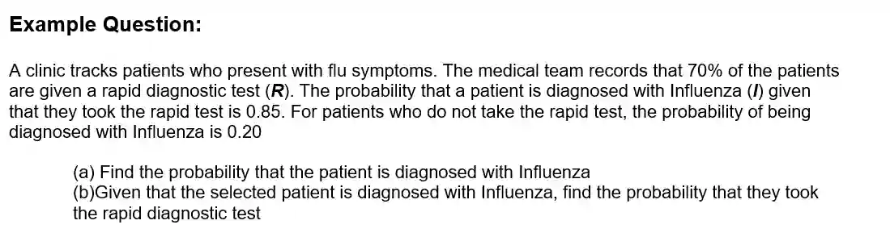

## Conditional probability

$\boxed {P(B\|A)=\frac{P(A\cap B)}{P(A)}}$

* This is the probability of B occurring given that A has occurred

$\boxed {P(B\|A^{\prime })=\frac{P(A^{\prime }\cap B)}{P(A^{\prime })}}$

* This is the probability of A occurring given that B has occurred

  * Event A: A patient has flu symptoms.

  * Event B: A patient tests positive on the diagnostic test

  * ${P(B\|A)=\frac{P(A\cap B)}{P(A)}}$ means the probability of a patient testing positive given that a patient has flu symptoms

### Multiplication rule

$\boxed{P(A\cap B)=P(A)\times P(B\|A)}$

* This is the probability of 2 events occuring at the same time

For independent events,

* $P(A\|B) = P(A\|B^{\prime}) = P(A)$

are all the same as the two events are not related to each other

**Answer:**

(a)

* $P(I)=P(R\cap I)+P(R^{\prime }\cap I)$
* $P(I)=(0.70\times 0.85)+(0.30\times 0.20)$
* $P(I)=0.595+0.060=\mathbf{0.655}$

(b)

* **Formula:**
  $P(R\|I)=\frac{P(R\cap I)}{P(I)}$

* $P(R\|I)=\frac{0.595}{0.655}=\frac{119}{131}\approx \mathbf{0.908}\text{\ (3\ s.f.)}$