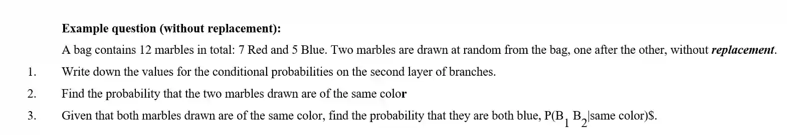
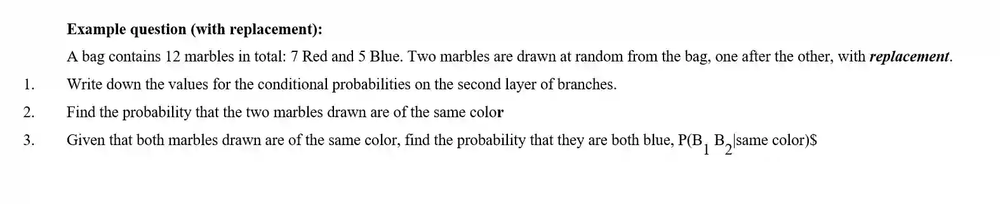

## Tree Diagrams

* Tree diagrams are ideal for chronological multi-stage processes or scenarios detailing sampling with or without replacement.

When drawing the tree diagram,

* The branches extending out from any single node must always add up to 1

* Moving Along Branches **(AND)**: Multiply probabilities along the path.

* Combining Paths **(OR)**: Add the final probabilities of distinct end branches together

* **With Replacement:** Probabilities remain identical on subsequent selections (events are independent)

* **Without Replacement:** Both the numerator and the denominator decrease by 1 for the next set of branches (events are dependent)

### Exam-styled questions

**Answer:**

1\.

2\.

$P(\text{same\ color})=P(R_{1}R_{2})+P(B_{1}B_{2})$

$P(\text{same\ color})=\left\(\frac{7}{12}\times \frac{6}{11}\right\)+\left\(\frac{5}{12}\times \frac{4}{11}\right\)=\frac{42}{132}+\frac{20}{132}=\frac{62}{132}=\frac{\mathbf{31}}{\mathbf{66}}\mathbf{\approx 0.470}$

3\.

$P(B_{1}B_{2}\|\text{same\ color})=\frac{P(B_{1}B_{2})}{P(\text{same\ color})}=\frac{\frac{20}{132}}{\frac{62}{132}}=\frac{20}{62}=\frac{\mathbf{10}}{\mathbf{31}}\mathbf{\approx 0.323}$

**Question 2:**

**Answer:**

1\.

Because the first marble is put back into the bag before the second draw, the probabilities remain exactly the same for both selections:

2\.

$P(\text{same\ color})=P(R_{1}R_{2})+P(B_{1}B_{2})$

$P(\text{same\ color})=\left\(\frac{7}{12}\times \frac{7}{12}\right\)+\left\(\frac{5}{12}\times \frac{5}{12}\right\)=\frac{49}{144}+\frac{25}{144}=\frac{\mathbf{74}}{\mathbf{144}}\mathbf{=}\frac{\mathbf{37}}{\mathbf{72}}\mathbf{\approx 0.514}$

3\.

\\(P(B\_\{1\}B\_\{2\}\|\\text\{same\\ color\})=\\frac\{P(B\_\{1\}B\_\{2\})\}\{P(\\text\{same\\ color\})\}=\\frac\{\\frac\{25\}\{144\}\}\{\\frac\{74\}\{144\}\}=\\frac\{\\mathbf\{25\}\}\{\\mathbf\{74\}\}\\mathbf\{\\approx 0.338\}\\)