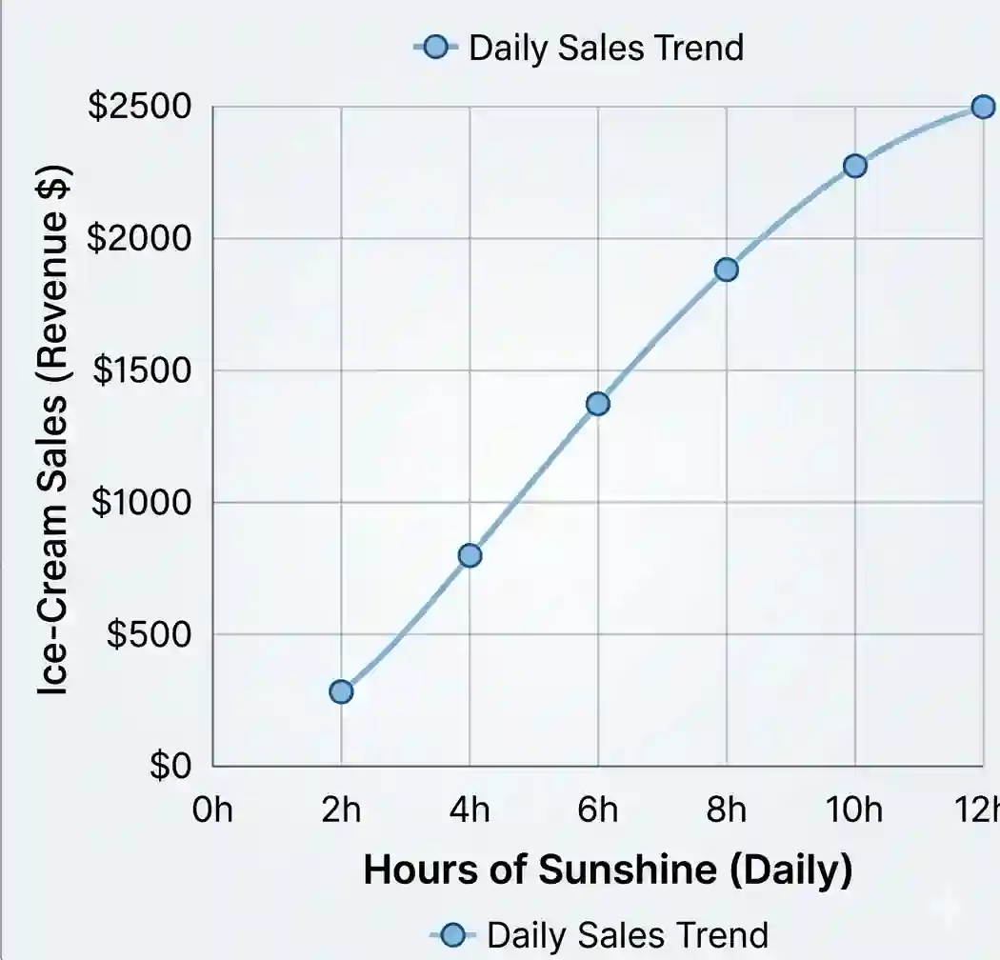

# Correlation and Regression

## Scatter diagrams

* Scatter Diagrams are visual plots of bivariate data

  * Bivariate data: data that consists of pairs of values for two variables, measured on the same individual or item (e.g. a person's height and weight).

### **Independent variables**

* Independent variable (explanatory variable): the variable that is controlled and not affected by the other variable

* It is always plotted on the x-axis

### Dependent variables

* Dependent variable (response variable): the variable whose value depends on the independent variable

* It is always plotted on the y-axis

Example: if you plot hours of sunshine against ice-cream sales, hours of sunshine is independent (x) and ice-cream sales is dependent (y), because sales respond to sunshine

### Types of correlation

* *Positive correlation*: as x increases, y also tends to increase (points go upward).

* *Negative correlation*: as x increases, y tends to decrease (points go downward)

* No correlation: no clear linear pattern between x and y

* Strong and weak correlation depends on whether the points are close to the line or scattered

* It is important to note that just because two variables have correlation doesn’t mean that one variable causes change in the other

  * For example: ice cream sales and drowning rates (both rise in summer due to hot weather but they are not related)

  