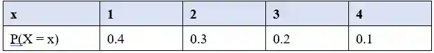
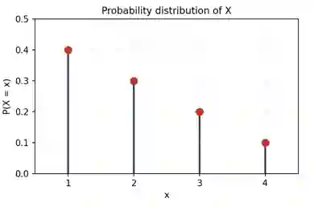

# Discrete Random Variable

## Understanding the discrete random variable and probability functions

* A random variable is a variable whose value depends on the outcome of a random experiment

  * We use a capital letter (eg. X) for the random variable, and a lowercase letter (eg. x) for one particular value it can take

* A discrete random variable is a random variable that can only take an integer value

* A probability function (or probability distribution) $p(x) = P(X=x)$ gives that X takes each value x

  * $p(x) = P(X=x)$ is the mathematical shorthand stating the probability that a general random variable equals a specific numerical outcome

  * For a standard six-sided die roll, $p(4) = P(X=4)$ means the probability that the random variable ($X$, the die score) lands on the specific outcome (x=4), which would be one-sixth

**Conditions for a probability function**

* every probability lies between 0 and 1

* all the probabilities of all possible outcomes must add up to 1

  * If a random variable (X) can only be the numbers 1, 2, 3, 4, 5, or 6:

    * P(1) \+ P(2) \+ P(3) \+ P(4) \+ P(5) \+ P(6) = 1

**Probability function**

Example: For a fair die, the random variable X represents the outcome. The function gives an equal probability to every face.

$P(X=x)=\frac{1}{6}\quad \text{for\ }x\in {1,2,3,4,5,6}$

$\sum _{x=1}^{6}P(X=x)=\frac{1}{6}+\frac{1}{6}+\frac{1}{6}+\frac{1}{6}+\frac{1}{6}+\frac{1}{6}=1$

**Table**

Example: A discrete random variable X has a probability function

$P(X = x) = \frac{5 − x}{10}, x = 1, 2, 3, 4$

Probability diagram

**Example question 1:**

* The random variable X has probability function $P(X = x) = kx$, for $x = 1, 2, 3, 4, 5$. Show that k = 1/15

  * P(X = x) = kx:

    * When $x = 1 \rightarrow P(X = 1)$ = k(1) = 1k

    * When $x = 2 \rightarrow P(X = 2)$ = k(2) = 2k

    * When $x = 3 \rightarrow P(X = 3)$ = k(3) = 3k

    * When $x = 4 \rightarrow P(X = 4)$ = k(4) = 4k

    * When $x = 5 \rightarrow P(X = 5)$ = k(5) = 5k

  * $ΣP(X = x) = 1$

    * 1k\+2k\+3k\+4k\+5k = 1

  * 15k = 1

  * k = 1/15

**Example question 2:**

* The random variable X has a probability function. $P(X = x) = kx $ for $x = 1, 3,$ and $P(X = x) = k(x + 1)$ for $x = 2, 4, $where k is a constant. (a) Find the value of k (b) Find $P(X > 1)$

  (a)

  * $P(1) = k, P(2) = 3k, P(3) = 3k, P(4) = 5k$

    $k + 3k + 3k + 5k = 1$

    $12k = 1$

    $k = 1/12$

  * (b)

    $P(X > 1)$

    $1 − P(X = 1)$

    $1 − 1/12$

    $11/12$