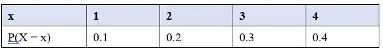
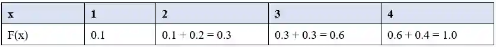

## Finding the cumulative distribution function

* The cumulative distribution function, written F(x) gives the probability that X is less than or equal to a given value: F(x) = P(X$\le$x)

  * It is a running total of all probabilities up to a certain point. Instead of asking "What is the chance of getting *exactly* x?", it asks "What is the total chance of getting **x** **or anything smaller**?”

* You add up the probabilities as you go to get a cumulative frequency table

* The final value of F(x) must always equal 1

  Example: X has the probability distribution:

  

  The cumulative distribution function adds the probabilities until that certain point:

  

***Key idea***

* $F(2.6)$ means $P(X ≤ 2.6)$. Since X can only take the integer values 1, 2, 3, 4, this is the same as $P(X ≤ 2), i.e. F(2.6) = F(2) = 0.3$

  * You round **down,** not up

* You cannot interpolate between values for a discrete random variable. F(x) is constant across every gap between consecutive possible values, then jumps at the next one.

**Example question 3:**

The random variable X has probability function P(X = x) = kx², for x = 1, 2, 3, where k is a constant.

* (a) Find the value of k and complete a table for P(X = x) and F(x)

* (b) Find F(2.4)

* (c) Find P(X \> 2).

**Answer:**

(a)

* k(1 \+ 4 \+ 9) = $\rightarrow$ 14k = 1 $\rightarrow$ k = 1/14

* 
  #|
  ||
  
  x

  |
  
  1

  |
  
  2

  |
  
  3

  ||
  ||
  
  P(X=x)

  |
  
  $\frac{1}{14}$

  |
  
  $\frac{2}{7}$

  |
  
  $\frac{9}{14}$

  ||
  |#
  

* 
  #|
  ||
  
  F(1)

  |
  
  F(2)

  |
  
  F(3)

  ||
  ||
  
  $P(X=1)$

  |
  
  $P(X=1) + P(X=2)$

  |
  
  $P(X=1) + P(X=2) + P(X=3)$

  ||
  ||
  
  $\frac{1}{14}$

  |
  
  $\frac{5}{14}$

  |
  
  $1$

  ||
  |#
  

(b)

* $F(2.4)=F(2)$ X is discrete, so no interpolation between 2 and 3
* $P(X <= 2)$
* $P(X=2) + P(X=1)$
* 0.1 \+ 0.2 $\rightarrow$ 0.3

(c)

$P(X > 2) = P(X = 3) = 9/14$