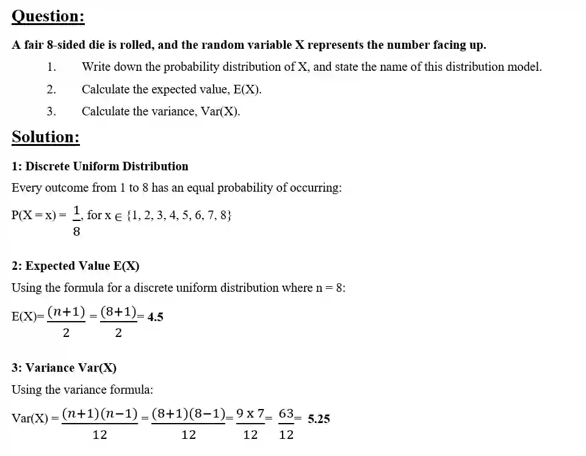

## The Discrete Uniform Distribution as a model

* A discrete random variable X follows a discrete uniform distribution when it is defined over a set of n distinct values, and every value is equally likely

  * such as a dice roll where the probability of getting 1 to 6 are all $\frac{1}{6}$
  * every outcome has the same chance of occuring

* In these cases,

  * E(X)= $\frac{(n+1)}{2}$

  * Var(X)=$\frac{(n+1)(n-1)}{12}$

$\boxed{\text{You are not expected to prove these but this will be good to know during exam questions}}$

