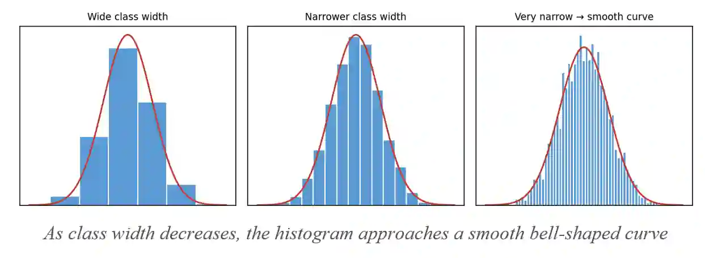
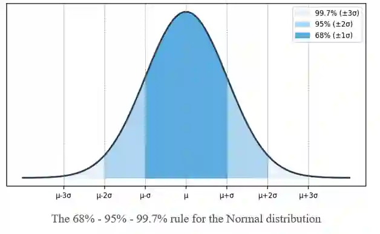

# **The Normal Distribution**

## An overview of the normal distribution, graphs and the empirical rule

### **Discrete vs continuous random variables**

* A discrete random variable can take only certain distinct, countable values (e.g. 0, 1, 2, 3...). The sum of the probabilities in a discrete probability distribution is equal to 1.

  * Example: flipping a fair coin twice and counting the number of times it lands on heads

  * 
    #|
    ||
    
    Number of Heads

    |
    
    Probability P(X=x)

    ||
    ||
    
    0

    |
    
    $0.25$

    ||
    ||
    
    1

    |
    
    $0.5$

    ||
    ||
    
    2

    |
    
    $0.25$

    ||
    ||
    
    Total

    |
    
    1

    ||
    |#
    

* Examples of discrete variables: number of goals scored, number of siblings, shoe size

* A continuous random variable can take any value within a given range (including decimals)

* Examples of continuous variables: height, weight, time, temperature, distance

### Normal distribution graph

* Many continuous variables that cluster around a central value (with equal spread at either side) follow a Normal distribution

  * Example: Heights of adults cluster around an average height, with fewer people much taller or much shorter.

* The distribution becomes bell-shaped and is symmetrical about the mean

  * Most people are close to average height with roughly equal numbers of taller and shorter people

    

* Take a large data set (like 1000 people) and group it into a histogram

* If you use wide class widths (like 150-160cm), you get a blocky histogram like the first image

* When you keep making the class widths smaller and smaller (like 1 cm bands, then 1 mm bands), the outline of the histogram gets smoother

* As the class width approaches zero, the histogram approaches a smooth, continuous curve (as shown in the image above). This is how a continuous probability distribution arises from grouped discrete data

* The notation of a normal distribution is

  * $X \sim N (\mu, \sigma^2)$
  * where $\mu$ is the mean, $\sigma^2$ is the variance and $\sigma$ is the standard deviation

### Characteristics of the Normal distribution

* Has two parameters: μ (the population mean) and σ² (the population variance)

* Is symmetrical, so mean = median = mode

* Has a bell-shaped curve with asymptotes at each end (the curve never actually touches the x-axis)

* Has a total area under the curve equal to 1 (since it represents total probability)

* Has points of inflection (where the curve changes from curving one way to the other) at μ \+ σ and μ − σ

### The empirical rule

* Approximately 68% of the data lies within 1 standard deviation of the mean: μ ± σ

* Approximately 95% of the data lies within 2 standard deviations of the mean: μ ± 2σ

* Approximately 99.7% of the data lies within 3 standard deviations of the mean: μ ± 3σ

**In real life example:**

Imagine a class of 100 students takes a test. The average score is 80, and scores typically vary by about 5 points from that average.

Given that the class follows the normal distribution,

* 68 students score between 75 and 85 (Within 1 gap of the average)

* 95 students score between 70 and 90 (within 2 gaps of the average)

* 99-100 students score between 65 and 95 (within 3 typical gaps)

So just from knowing the average and the typical spread, you can instantly predict where most of the class's scores will fall