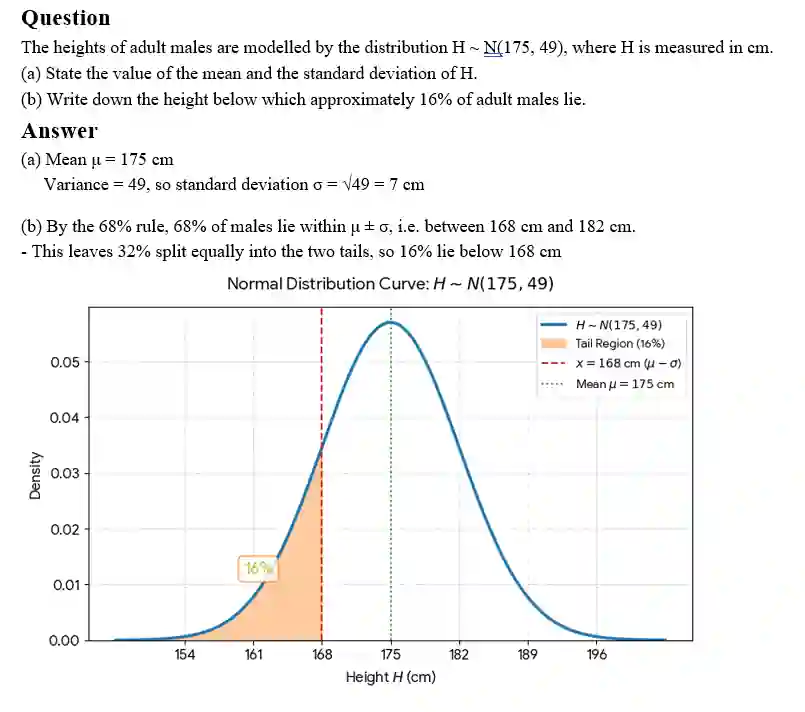

## Example Question

### *Exam Tip*

* Always draw a quick sketch of the Normal curve for any question.

* Mark the mean, shade the region you want, and label any known z-values or x-values

* On a calculator, the Normal cumulative distribution function is usually found under Distribution/Stat menus, which is often labelled as Normal C.D. or Normal CD

  * you enter the lower bound, upper bound, σ and μ directly, rather than reading tables.

**Exam-styled question**

