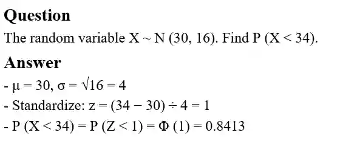

## The Standard Normal Distribution

* Real-world Normal variables can have any mean and variance, but tables only exist for one specific Normal distribution — the **standard** Normal distribution, Z \~ N(0, 1).

* By converting data into the standard normal distribution, we can find probabilities for any dataset using just one standard table (this was created by mathematicians before calculators existed)

* To use the tables for a general X \~ N(μ, σ²), you must first convert/standardise X into Z using:

  * $\boxed{Z = \frac{(X − μ)}{σ}}$

* This works because subtracting μ shifts the mean to 0, and dividing by σ rescales the spread to a standard deviation of 1, without changing the shape of the distribution

**Exam styled question**

