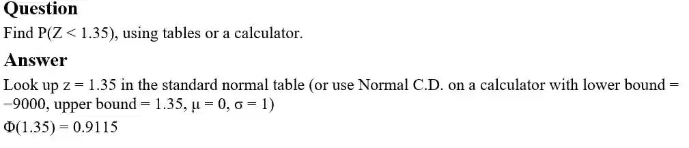

## Finding Probabilities of the Standard Normal Distribution Z

* Normal tables are provided in the formula booklet so you do not need to memorise them

* The mathematicians devised the standard normal distribution so that we would be able to easily find the probability without having to do many calculations (before calculators existed)

* The standard normal variable is usually denoted by **Z**, and has a mean of 0 and a standard deviation of 1, written

  * **Z \~ N(0, 1)**

* the probability that Z is less than some value z is

  * P(Z \< z) = Φ(z)

  * The tables in the formula booklet give the value of Φ(z) directly — you look up z (to 2 decimal places) and read off the probability

  * However, it is faster to just use your calculator to find the answer

### Exam styled question

Answer: $P(Z < 1.35)$ = 0.912 (3 s.f.)