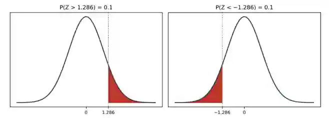

## Finding the Value of z given a probability

- The standard normal table only shows less-than probabilities: Φ(z) = P(Z \< z)
  - Again, since Z is continuous, P(Z = z) = 0, so including or excluding the single value z does not change the probability.
- To find z given a probability, you use the table “backwards” (or inverse normal function), looking for the probability inside the table and reading off the corresponding z-value

### **Using symmetry**

* The standard normal curve is symmetrical about 0, so tail probabilities on either side mirror each other.

* Therefore, if P(Z \> 1.286) = 0.1, then P(Z \< −1.286) = 0.1 as well

  

* the right-hand tail beyond 1.286 has exactly the same area as the left-hand tail beyond −1.286

### **Exam styled question**

