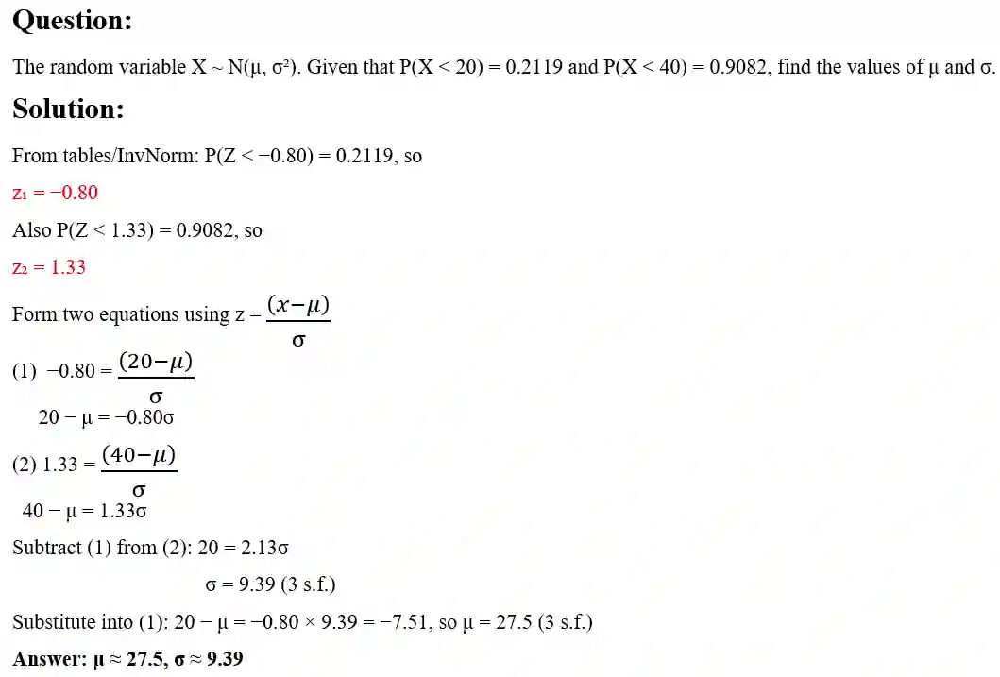

## Finding **μ and σ**

* Some questions give you one or more probabilities involving X\~N $(μ, σ^2)$ and ask you to find μ and/or σ

* standardise each given probability to get an equation in z, by either using the tables (or inverse normal function) to find the corresponding z-value, then form an equation linking x, μ, and σ using z =$\frac{ (x − μ) }{σ}$

* If both μ and σ are unknown, you will need two equations (from two given probabilities) and solve them simultaneously

### Using your calculator

- Use the inverse Normal function (often called InvNorm) on your calculator to find a z-value or x-value directly from a given probability, instead of reading it from the tables.
- You may use your calculator to find probabilities directly in the exam, but you should clearly state the probability you are finding (e.g. write “P(Z \< 1.5)” or “Φ(1.5)”) before giving your final numerical answer, and give your final answer correct to 3 significant figures.

**Exam styled question using simultaneous equation:**

