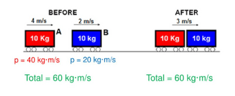
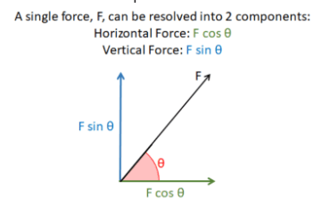
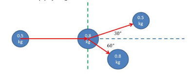
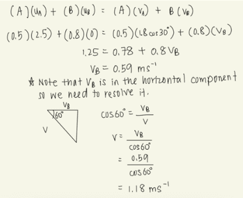

## Application of Conservation of Linear Momentum in Two Dimensions

* Linear momentum refers to the momentum of an object moving in a straight line.
* The principle of conservation of linear momentum states:

The total momentum before a collision = The total momentum after a collision provided no external forces act

Momentum is a vector quantity, so remember to define whether it is “positive” or “negative.”

* For objects moving in 2D, there are components of momentum to consider.
* This applies the same concept we learned at AS Level about resolving forces.

**Quick recap:**

**Apply this concept to momentum:**

Consider the 0.5kg ball as A and the 0.8kg as B.

A travels at 2.5$ms^{-1}$ and collides with B, which is at rest.

The collision angle is such that A moves off at 30° above the horizontal at 1.8$ms^{-1}$ and B moves off at 60° below the horizontal, with a speed of $v$. Determine the size of $v$.

**Working Steps:**

