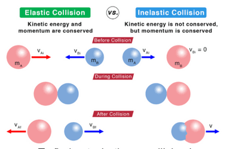

## Elastic and Inelastic Collisions

* In both collisions and explosions, momentum is always conserved
* However, kinetic energy might not always be
* A collision (or explosion) is either:
  * Elastic – if the kinetic energy is conserved
  * Inelastic – if the kinetic energy is not conserved
* Collisions happen when objects strike against each other
  * Elastic collisions are commonly those where objects colliding do not stick together; instead, they strike each other and then move away in opposite directions.
* Inelastic collisions commonly involve objects colliding and sticking together after the collision.

  

* To determine whether a collision is elastic or inelastic, compare the kinetic energy before and after using the formula $E\\_k$ =\frac{1}{2} mv$^2$.