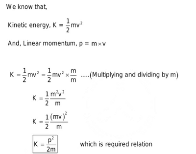
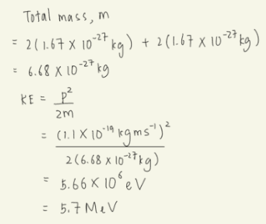

## Energy-Momentum Relation

**Derivation of the Energy-Momentum Relation**

**This equation is used for:**

* Calculations involving the kinetic energy of subatomic particles traveling at non-relativistic speeds (i.e., much slower than the speed of light)
* Projectiles and collisions involving large masses
* Example: Calculating the Kinetic Energy of an Alpha Particle

An alpha particle is composed of two protons and two neutrons. We can use the given momentum and the masses of protons and neutrons to calculate its kinetic energy.

**Given data:**

Mass of a proton $(m\\_p)$ = $1.67 × 10^{-27}$ kg

Mass of a neutron $(m\\_n)$ = $1.67 × 10^{-27} kg$

Momentum of the alpha particle

$(p) = 1.1 × 10^{-19} kg m/s$

Working Steps:

