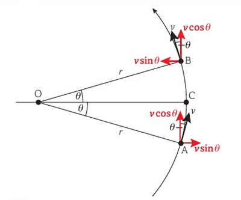

## Centripetal Acceleration

* An object in a circle usually travels at constant speed and constant angular velocity.
* It is constantly accelerating to change its velocity (vector version of speed) so that it can change its direction.

**Derivation of Centripetal Acceleration from Angular Velocity**

At the arbitrary positions of the rotating object, A, and at a time $t$ later, B, we consider the components of the object’s velocity, in the $x$ and $y$ directions

As A and B are equal distances above and below point C, the vertical velocity component, $v\\_y$ is the same in both cases:

$v\*y = v\*{cos\theta}$

So the vertical acceleration is zero:

$a\\_y = 0$

Horizontally the magnitude of the velocity is equal at both points, but in opposite directions:

at A: $v\\_x = vsin\theta$

at B: $v\\_x = -vsin\theta$

So the acceleration is just the horizontal acceleration, calculated as change in velocity divided by time

$a\\_x = \frac{2vsinθ}{t}$

From the definition of angular velocity above:

$v = \frac{rθ}{t}$

∴  $t = \frac{rθ}{v}$

Here the angle moved in time $t$ is labelled as t = 2θ, so:

$t = \frac{r2θ}{v}$

$a\\_x = \frac{v2vsinθ}{r2θ} = \frac{v^2}{r}\frac{sinθ}{θ}$

Using small angle approximations:

$\frac{sinθ}{θ} = 1$

∴  centripetal acceleration, $a = \frac{v^2}{r}$

From the definition of the instantaneous velocity above:

$v=rω$

∴  $a = \frac{rω^2}{r}$

∴  centripetal acceleration, $a = rω^2$