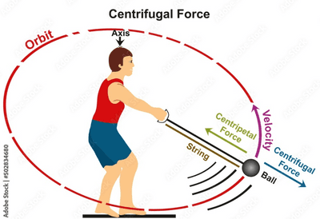

## Centripetal Force

* **Centripetal force**: resultant force towards the circle's centre to maintain an object’s circular motion.

* **Recap**: An object moving in a circle must constantly accelerate toward its centre to maintain its motion around the circle. Note that the magnitude of the velocity never changes—only the direction of the velocity changes.

  

* According to Newton’s First Law, when the hammer thrower lets go of the hammer, the hammer will fly off in the direction following the straight line of its instantaneous velocity (a tangent to the circular orbit).

* This happens because no resultant or centripetal force is acting upon the hammer.

* The hammer also has an angular velocity.

### **Derivation of Centripetal Force**

$ F = ma$

$a\\_x = rω^2$

$F\\_c = m(rω^2)$

$= m(r)(\frac{v}{r})^2$

∴ $F\\_c = \frac{mv^2}{r}$ or $F\\_c = mrω^2$

From this formula, we can deduce that the centripetal force is larger when:

* The rotating object has more mass
* The object rotates faster
* The object is closer to the centre of the circle

**Exam Tips:** Make sure to use the term “centripetal force” and not centrifugal force in the Edexcel IAL syllabus.