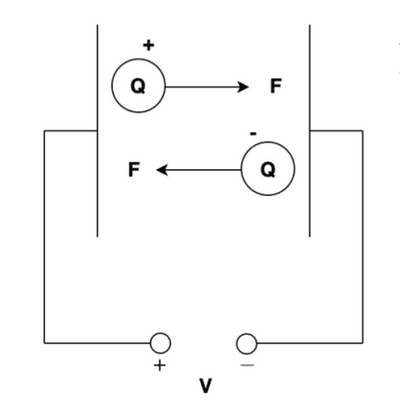
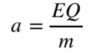
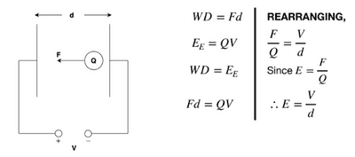
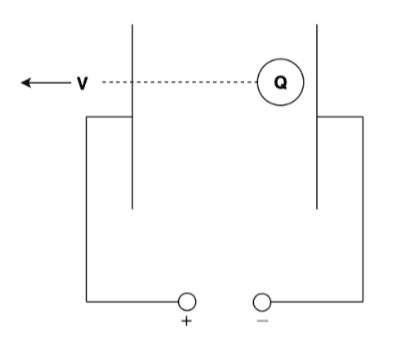
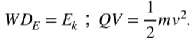

# Electric Fields

## Electric Fields

* The electric field is a region in space in which a charged object experiences a force.
* To visualize the forces caused by the field, we draw electric field lines that show the direction in which a positively charged particle will be pushed by the force the field produces.
* Like all field patterns, the closer the lines are together, the stronger the field is. The force that a charged particle will feel is the electric field strength $(E)$ multiplied by the amount of charge on the particle in coulombs $(Q)$, as given by the equation:

$$

F=EQ

$$

* From this force equation, we can also quickly calculate how a charge would accelerate. Newton\`s second law states that F=ma, so we can equate the equations for force:

$$

F =EQ =ma

$$

Therefore:

* Electric field strength $E$ is a vector quantity. The direction of $E$ is the same as the direction of the electric force $F$, which is defined as the force on a positive charge.

**The link between work and energy in a uniform electric field**   

* The equation $E=\frac{V}{d}$ is the intrinsic equation for the electric field strength, and this equation can be used when no other external quantities are known.

### **Energy Conservation in Uniform Electric Field**

* The kinetic energy the charged particle gains equals the electrical energy/electrical work done on it.

