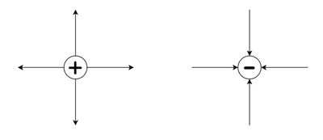
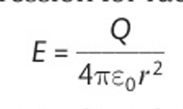
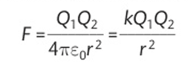
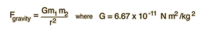
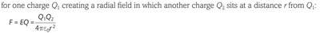

## Radial Electric Field

* In a radial electric field, the field lines are along the radius.
* Radial electric fields exist around point charges. For example, around a proton or an electron.
* The shape of the electric field around a positively charged particle is radially outward. The shape of the electric field around a negatively charged particle is radially inward. This is illustrated in the diagrams:

Radial Electric Field Strength can be calculated using:

* The permittivity of free space, $\varepsilon\\_0$, is a physical constant used often in electromagnetism. It represents the capability of a vacuum to permit electric fields.

### **Coulomb’s Law**

* Coulomb’s law states that the force between two charged particles is directly proportional to the product of the charges and inversely proportional to the square of the distance between the two charges. This is illustrated in the diagram below:

* Here’s a more intuitive way to look at it:

* You should notice that the formulas for Coulomb's and Gravitational Law are very similar in that they operate by the inverse square and have constants. THEY ARE different because the constant $G$ is very small, and the constant $k$ is very big. They also differ because gravity is always attractive, and charges can attract or repel. One uses the product of the charges; the other uses the product of the masses.
* Also, Coulomb’s Law is a logical continuation of the radial electric field strength.

