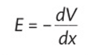
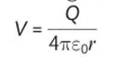

## Electric Potential

* The electric potential, $V$, at a point, is the work done per unit positive charge on a positive test charge when moved from a point infinitely far away from any charges to that position.

* It can also be thought of as the amount of energy it would take to remove a negative charge from a positive field from that point or the amount of energy gained by a positive charge when it moves from that point to infinitely far away.

* Electric potential is a scalar quantity because it is just an amount of energy per charge (it has no direction)

* The electric field strength is the rate of change in potential difference, $V$, with the distance, $x$. The formula gives this:

  \
  

* Therefore, 

   