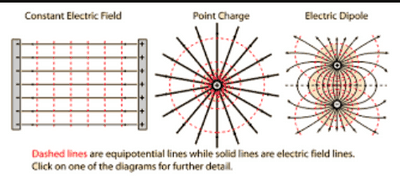

## Field Lines and Equipotentials

* Equipotentials are surfaces (in 3D) or lines (in 2D) connecting points of equal potential. A test charge moving along an equipotential has constant potential energy. The electric field does not work.

* Due to single-point charge, Equipotential surfaces are concentric spheres with the charge at the centre.
* Equipotential lines are always:
  * Perpendicular to the electric field lines in both uniform and radial fields
  * Represented by dotted lines