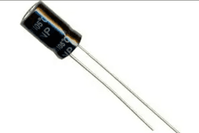
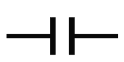
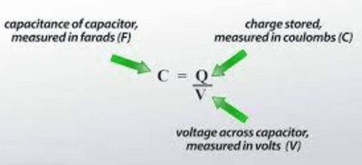

# Capacitance

## Introduction

* The image shows a capacitor

* It is an electrical device that stores energy as an electric charge. It's a two-terminal passive component that stores electrical energy in an electric field

* As shown in the picture, a capacitor has two conductive metal plates

* Thus, this is how we draw the capacitor’s symbol:

* Capacitance is the charge stored per unit potential difference between the plates

* The charge refers to the charge stored on the metal plates.