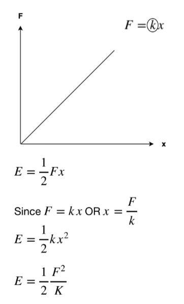
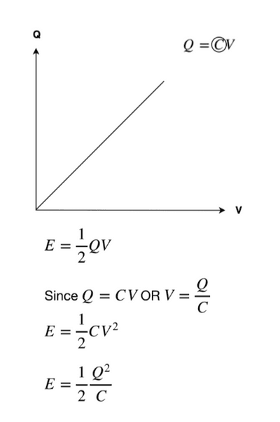

## Energy Stored by a Capacitor

* Recall the formula used for Hooke’s Law
* It can give us an intuitive sense of how to derive the equation of energy stored by a capacitor

**Relating this to capacitance:**

