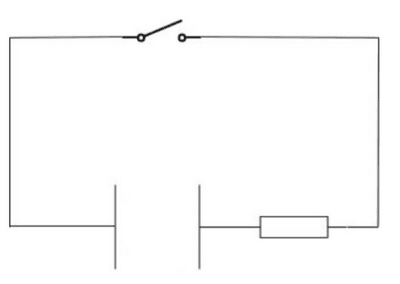
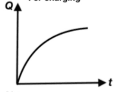
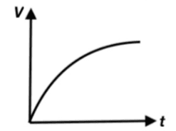
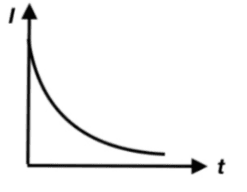
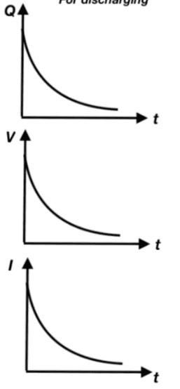

## Charge and Discharge Curves

* Earlier, we saw how capacitance stores charge. Now, we will also look at how it discharges:

* When the switch is closed, the charges re-distribute by flowing from one plate to the other until each plate has an equal number of positive and negative charges.

**Charging Curves**

1. Charged stored against time

* The charge stored will increase with time because the capacitor is storing charges.
* It starts to plateau because no more electrons can eventually be pushed onto the negative plate, stopping the charging.

2. Potential Difference against time

* This graph has a similar shape to the previous one about the charge
* The potential difference between the plates slowly increases until it is the same as the power supply because an equal but opposite charge builds up on each plate

3. Current against time

   

* Initially, the current is large but starts to fall to zero when electrons stop flowing.
* This is called an exponential decay graph.
* The rate at which the charge decreases is proportional to the amount of charge it has left.

**Discharging Curves**

* The discharging curves for a stored charge, potential difference, and current all have the same shape - the exponential decay graph.
* At the start, the current/amount of charge/potential difference is large and gradually falls to zero.