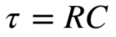
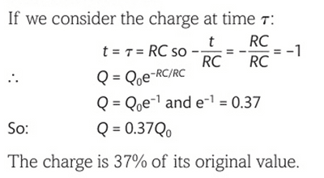

## Time Constant

* The time constant is represented with the Greek letter **τ,** tau.

* This time constant determines the rate at which a capacitor charges or discharges. Numerically, the time constant is the time taken for an associated quantity to drop down to 37% or 63%. This time constant can be considered analogous to half-life in radioactive decay, just as half-life is the time taken for the value to decrease by 50%. Similarly, the time constant is when the value decreases by 63%.

