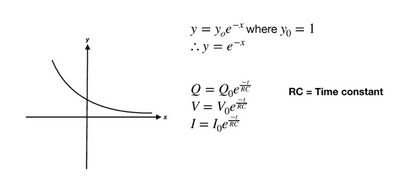
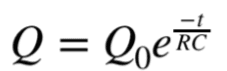
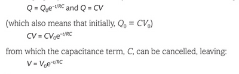
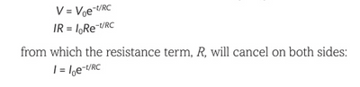
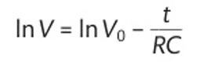
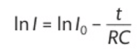
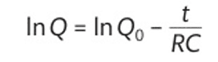

## Exponential Discharge in a Capacitor 

When a capacitor discharges, the charge stored decreases exponentially

but since Q=CV, we can also derive another equation:

**Next, Ohm’s Law, V=IR,  is required to derive the third formula:**

You can convert these three equations into log format:

    Using the log equations, a linear graph can be plotted