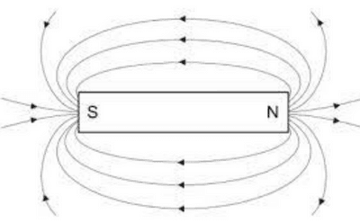
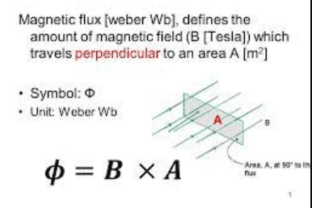
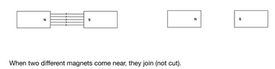
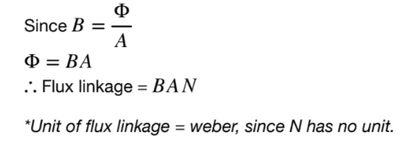
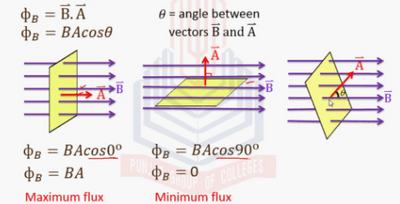

# Magnetic Fields

## Electromagnetic Effects

* Electromagnets are used in the electrical sector, especially in transformers, which vary the amount of voltage depending on the number of coils.

**KEY TERMS:**

**Magnetic Field**

* The magnetic field is a region where a magnetic pole of current-carrying wire experiences a force.
* This concept can be linked to an electric field, except we are dealing with magnetic poles instead of charges.
* The direction of a magnetic field always goes from north to south
* Magnetic field lines = magnetic flux
* The closer the lines, the greater its strength
* Magnetic Flux Density, $B$, has the unit Tesla $(T)$. It is also known as the magnetic field strength

* Magnetic field lines are concentrated at the poles' ends so metals are immediately attracted to the ends of the poles of a bar magnet.
* Magnetic Flux measures the total magnetic field that passes through a given area.

* Flux linkage is cutting field lines by a coil or through a coil. In more technical terms, flux linkage is the interaction of field lines (flux) with a certain number of turns of a coil.

$\phi=N \phi$ represents flux linkage

where $Φ$ is the magnetic flux, and N is the number of coils

* Of course, magnetic flux can also occur at different angles with the plane.

