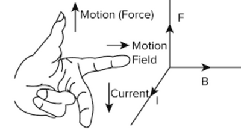

## Fleming’s Left-Hand Rule

* In F.L.H.R., the finger represents the direction of the quantities. The fingers do not represent the quantity themselves.

  • The direction of the thumb indicates the direction the force

  • The direction of the index finger indicates the direction of the magnetic field

  • The direction of the middle finger indicates the direction of the current

 