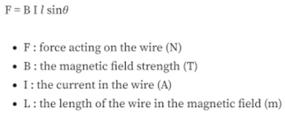
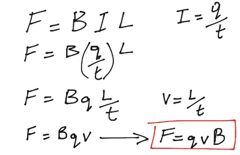
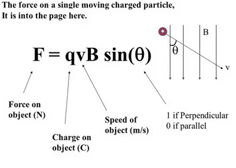

## Magnetic Forces

* Earlier we looked at Fleming’s Left Hand Rule to determine the direction of force upon a current-carrying conductor in a magnetic field
* We can calculate that force using the formula:

* However, we assume that the magnetic flux is parallel to each other when using this formula

When θ = 90 degrees, $F = BIL$

Application of Formula:

* A motor would be more powerful when you increase the force acting upon it. This can be done by:
  * Increasing magnetic field $(B)$
  * Increasing the number of turns of the wire (increases length)
  * Increase the magnitude of the current

**Force on Particles**

* Recall that electrons flow in opposite directions to the current

* In a current-carrying wire, there are charged particles that are known as electrons

* According to FLHR, we determine the force acting on the electron that is moving in the magnetic field

* Since the electron is contained in the wire, the force transfers to the wire instead whereas if it was free-moving, its direction would change to make it move in a **circular path**

* Therefore, we can link this to the **centripetal force**

* This force acts at right angles to the field and right angles to its direction of motion, which is exactly what FLHR states

* **Thus,** $F=BqV$

* Again, this formula requires the use of angles:

  