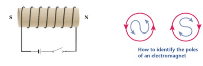
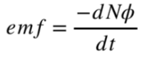
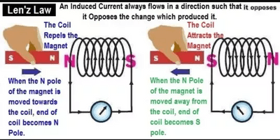

## Electromagnetic Induction

* Recall that a force acts on a charged particle in a wire in a magnetic field
* This force is the electromotive force (emf), which is the work done to move charges across the complete circuit
* To reverse the polarity of emf, we must reverse the direction of the magnetic field or relative motion so the direction of the force on the electron is reversed

Identifying poles of an electromagnet:

1. Determine the end at which current enters the coil.
2. Identify the direction of the current at that end.
3. If the direction of the current at an end is clockwise, that end becomes the south pole.
4. If the direction of the current at an end is anti-clockwise, that end becomes the north pole.

**Induced emf**

When a conductor moves relative to a magnetic field, it cuts the magnetic flux. This induces an emf, which gives rise to an induced current. This can be better explained by the following laws:

**Faraday’s Law**

* Faraday’s Law states that the induced emf is directly proportional to the rate of change of flux linkage

  Induced emf can be increased by :

  * Increasing the number of turns of the coil
  * Using a stronger magnet
  * Moving the magnet faster

**Lenz’s Law**

* According to Lenz’s Law, the direction of an induced emf is such as to oppose the change causing it

