# Nuclear and Particle Physics

## Particle Physics

### **1 - Alpha Particle Scattering**

* Geiger and Marsden undertook an experiment in which they aimed an alpha particle source at an extremely thin gold foil.
* They expected all the alpha particles to pass through, possibly with little deviation.
* The results generally followed this pattern – most passed straight through the foil. However, several alpha particles had their trajectories deviated by quite large angles. Some were even repelled back the way they had come.

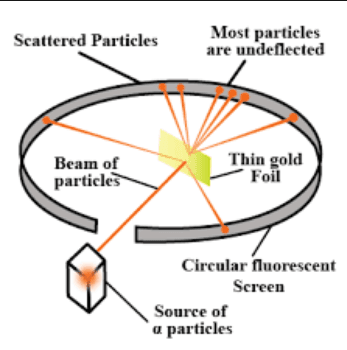

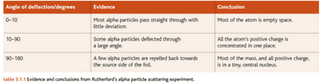    

### **2 - Nuclear Structure**

* The nucleus comprises two particles: the proton and the neutron.
* When in a nucleus, these two particles are collectively known as nucleons.
* The number of protons in a nucleus determines which element the atom will be. The periodic table lists the elements ordered according to the number of protons in each atom’s nucleus. This number is called the proton number or the atomic number.
* For small nuclei, the number of neutrons in the nucleus generally equals the number of protons. Above atomic number 20, more neutrons than protons are generally needed for the nucleus to be stable.
* The neutrons help to bind the nucleus together as they exert a robust nuclear force on other nucleons, and they act as a space buffer between the mutually repelling positive charges of the protons.

### **3 - Electron Beams**

* Free conduction electrons in metals need a certain amount of energy to escape from the surface of the metal structure.
* The electrons can gain enough energy through the heating of the metal.
* The release of electrons from the surface of a metal as it is heated is known as **thermionic emission.**
* If, on escaping, these electrons find themselves in an electric field, they will be accelerated by the field, moving in the positive direction. The kinetic energy they gain will depend on the PD, $V$, that they move through, according to the equation:

Kinetic Energy = $eV$

* Using thermionic emission to produce electrons and applying an electric field to accelerate them, we can generate a beam of fast-moving electrons, traditionally known as a cathode ray. A magnetic field will deflect this beam of electrons. If a fast-moving electron hits a screen painted with a specific chemical, the screen will fluoresce – emitting light.

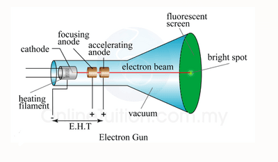

### **4 - Electron as Waves**

* Electrons do not just behave as particles – they also have wave properties. De Broglie’s wave equation relates the wavelength of a particle to its momentum:

  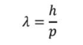

* The idea of electrons acting as waves has allowed scientists to study the structure of crystals. When waves pass through a gap about the same size as their wavelength, they are diffracted – they spread out. The degree of diffraction spreading depends on the gap size ratio to the wave's wavelength.

* Electron diffraction and alpha particle scattering both highlight the idea that we can study the structure of matter by probing it with beams of high-energy particles. The more detail – or smaller scale – the structure to be investigated, the higher energy the beam of particles needs.

### **5 - Particle Accelerators**

* To investigate the internal substructure of particles, scientists collide them with other particles at very high speeds (very high energies).
* If we can combine particles hard enough they will break up, revealing their structure. In most cases, additional particles are created from the energy of the collision.
* The challenge for scientists has been to accelerate particles to sufficient speeds. Charged particles can be accelerated in straight lines using a potential difference, and their direction is changed along a curved path by a magnetic field.

**Linear Accelerators (LINAC)**

* A linear accelerator operates on the same principle as an electron gun – electrons or other charged particles are accelerated across gaps between charged electrodes. Many drift tubes are often connected to a high-frequency, high-voltage AC supply in a linac.

* These are arranged so the particles gain kinetic energy between the tubes and move at constant speed inside the tubes.

* The main principles are:

  * Alternate tubes are connected to each terminal of the AC supply.

  * The charged particles spend one-half of each period of the alternating voltage between two tubes and the other half of each cycle inside one of the tubes.

  * During a half-cycle, when the voltage opposes their motion, the particles are inside a tube, shielded from the electric field; the particles travel at a constant speed within the tube.

  * The particles gain kinetic energy as they travel across successive gaps and can be accelerated to high energies.

**Popular Exam Question**: Why does the length of the drift tubes increase along the accelerator?

* Because although the speed of the particles is increasing, the time needed to pass through each tube will always be the same (equal to the half period of the alternating electric field). Therefore, the distance travelled by the particle in that period increases.

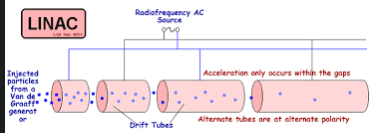

**Cyclotron**

* The main disadvantage of linear accelerators is that to produce high energies, they need to be **very long.**
* Based on the same principle of synchronous acceleration as linacs, Cyclotrons use a magnetic field to make the charged particles move in a spiral path, accelerating particles in circles
* By Fleming’s left-hand rule, a particle carrying a charge $q$ moving with speed $v$ at right angles to a magnetic field of flux density $B$ will experience a force of magnitude $Bqv$ in a direction perpendicular to its motion. The particle will therefore follow a circular path, and we have:

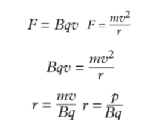

**How does a cyclotron work?**

* A cyclotron consists of two hollow, semicircular D-shaped sections placed at right angles to a uniform magnetic field and has a high-frequency alternating voltage applied between them.
* An ion source fires charged particles into the gap between the dees close to the centre.
* When the polarity is appropriate, the particles are accelerated across the gap during a half-cycle of the alternating voltage.
* During the next half-cycle, the particles follow a circular path at constant speed in one of the dees.
* The particles are then accelerated across the gap into the other dee.
* Faster particles follow paths of greater radius so that all particles spend the same time in the dees, and their acceleration is synchronised with the appropriate half-cycle of alternating voltage.

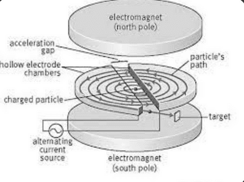

**Relativistic effects**

* For speeds approaching the speed of light, relativistic effects must be considered.
* It is a basic postulate of the theory of relativity that nothing can travel beyond the speed of light.
* Therefore, for energy to be conserved, the mass of the electron must increase. Relativistic effects can therefore create synchronisation problems in high-energy particle accelerators.
* Synchrotrons, such as CERN, account for these relativistic effects and can produce particles with extremely high energy.

### **6 - Particle Detectors**

* Particles can be detected when they interact with matter to cause ionisation or when they excite electrons to higher energy levels, accompanied by the emission of photons. In bubble tanks and cloud chambers, a charged particle passing through will generate a trail of ions along which bubbles or vapour droplets are formed, making these paths visible.
* The nature of the particles can be deduced from the length of trails they leave and from how these paths are affected by electric and magnetic fields.

**Interpreting Images**

* Neutral particles do not produce a trail and cannot be observed.
* Oppositely charged particles are deviated in opposite directions, which is determined by Fleming’s left-hand rule.
* From the relation $r = \frac{p} {Bq}$, we can infer that particles with greater momentum spiral less, so trails with greater radius indicate massive and/or energetic particles.
* A thicker trail indicates more intense ionisation, usually due to the particle's greater momentum or charge.
* Particles spiral inwards. This is because their momentum decreases as they lose energy, and the path radius becomes smaller.

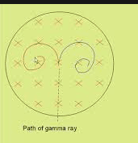

### **7 - Particle Interactions**

**In any interaction:**

* Momentum is conserved
* Mass/Energy is conserved
* Charge is conserved.
* Baryon number is conserved.
* Lepton number is conserved.
* Strangeness is conserved.

**Conservation of mass-energy**

The rest mass of particles can be represented as an equivalent energy utilizing Einstein’s equation:

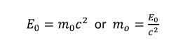

* The rest mass can be thought of as the energy that would be transferred if the entire mass were dematerialised or if the particle were made up entirely from other forms of energy. Remember mass of particles moving close to the speed of light is greater than their rest mass. This is because nothing can travel beyond the speed of light; thus, mass must increase for momentum to be conserved. The mass of moving particles can be the same as their rest mass unless the speed is close to the speed of light. Units of mass and energy

* It is often convenient to represent the rest mass of subatomic particles in terms of the non-SI units.

* Another unit used in particle physics is the unified atomic mass unit, denoted by $u$. It is defined as one-twelfth of the mass of a carbon-12 atom, so

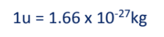

### **8 - Pair Production and Annihilation**

**Pair Production**

* The phenomenon whereby a particle and its anti-matter equivalent are both created simultaneously in conversion from the energy of a photon that interacts with a nucleus

* Anti-matter has the same mass but opposite properties to the normal matter particle.

* Photons are used to overcome the bonding energy of the nucleus in pair production. This is a diagram of pair production:

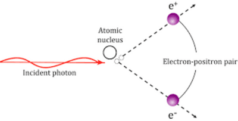

* According to the Principle of Conservation of Momentum:

  * The gamma-ray had horizontal momentum, so the electron and positron pair obtained the horizontal momentum from the Gamma-ray.
  * The gamma-ray has no vertical momentum, so since the electron and positron pair are in opposite directions, their vertical momentum cancels out and = 0.

**Annihilation**

* According to $E = mc^2$, an equation in Einstein's theory of special relativity that expresses the equivalence of mass and energy, matter appears spontaneously through a conversion from energy. In contrast, energy can appear through the disappearance of mass.
* Annihilation is when a particle and its anti-matter equivalent are both destroyed simultaneously, disappearing and then are converted into energy in the form of 2 Gamma ray photons

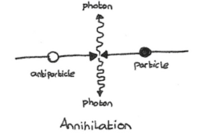

**Electronvolt Units**

* 1 $eV$ is the amount of energy gained by an electron when it is accelerated through a potential difference of one volt
* $1 eV = 1.60 x 10^{-19}$ J
* Usually, we would use $MeV$ or $GeV$

### **9 - The Standard Model**

* The Standard Model consists of fundamental particles, particles that can not be split into further fragments:

Quarks

* They are strongly interacting particles and are believed not to exist singly. They occur in two possible combinations.
  * **In quark**–anti-quark pairs, called mesons
  * **In quark, triplets** are called baryons.
  * Collectively mesons and baryons are referred to as hadrons. The proton and the neutron are familiar examples of baryons.

Leptons

* Leptons are weakly interacting particles. Leptons occur singly; the electron to a familiar example of a lepton.
* The standard model has six quarks, six leptons, and their antiparticle equivalents.

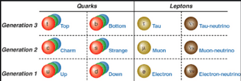

### **10 - Wave-Particle Duality**

* Diffraction patterns can be observed when high-energy electrons from an electron gun are fired through a thin slice of carbon, indicating that the electron, as well as being a particle, behaves like a wave.
* It is also possible to measure the radiation pressure of light from the Sun, which shows that photons have momentum, an attribute to all particles. This wave-particle duality applies to all particles, but it is significant only on a subatomic scale.
* De Broglie’s wave equation expresses the relationship between the momentum $p$ of a particle and its wavelength:

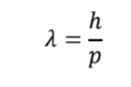

* The electron diffraction experiment also observed that the higher-energy electrons produced have a shorter wavelength when the voltage across the electron gun increases. This relationship can be seen from Planck’s photon equation.

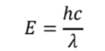

* The wavelength of a 100 $keV$ electron is of the same order of magnitude as the diameter of a carbon atom, so a noticeable diffraction pattern is produced when an electron beam is focused on a specimen containing carbon.
* This principle is applied to electron microscopes. If a high-energy accelerator is used, the wavelength of the electrons will be much shorter, enabling the structures of hadrons to be probed using deep inelastic scattering.