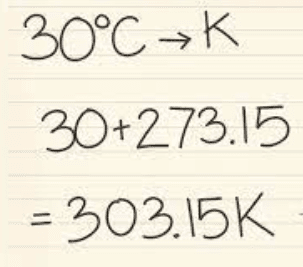

# Thermodynamics

## Heat and Temperature

### **Temperature**

* Temperature is a physical quantity which determines the direction of the flow of heat between two objects.
* According to the kinetic theory, microscopic particle movements predict a substance's macroscopic behaviour.
* If the average kinetic energy of a substance is greater, it will be at a higher temperature.
* The internal kinetic energy is distinct from the overall movement of an object.
* For example, a ball flies in the air, meaning it has kinetic energy. Its molecules vibrate within it, and this determines the temperature.

### **Absolute Temperature**

* Absolute zero is the theoretical temperature whereby molecules are no longer moving because all the kinetic energy is removed.

* The unit is Kelvin (K)

* To convert degrees Celcius into Kelvin, you must add 273 to the value in degrees Celcius. Remember to include the unit for Kelvin.

