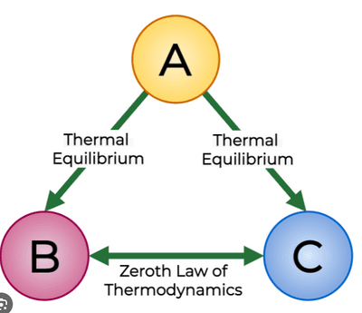

## Heat Transfer

* Objects have an internal energy

* A molecule in a substance that has more energy will “pull on” the molecule with lesser energy.

* The energy is shared evenly, so one molecule slows down, and one speed up

* This is related to thermal equilibrium, where heat energy passes from a hotter area to a colder area

  According to the 0th Law of Thermodynamics, if two objects of different temperature are placed close to one another, heat flows from one object to the other, as long as there is a temperature difference between them.

Next, when two objects have reached the same temeprature, there is no net flow of heat so they are in thermal equilibrium. if the final common temperature of the objects A and B is θ, then the heat energy provided by object can be represented by:

$$

H\\_A = {m\\_A}{c\\_A}{(\theta\\_2 - \theta)}

$$