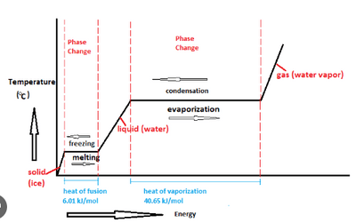
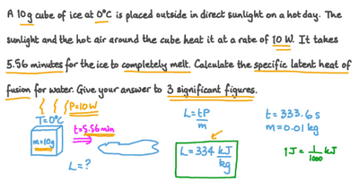

## Specific Latent Heat

* **Specific Latent Heat** is the energy required to change the state of 1kg of a substance at a constant temperature.
* **Types of Latent Heat**
  * Specific Latent Heat of Fusion: Involved in melting
  * Specific Latent Heat of Vapourisation: Involved in boiling
* The temperature is not raised because it is used to break the bonds between molecules to change the state of the material.
* Again, different materials and phases of the same substance have different specific latent heat.

$$

\Delta E = L\Delta m

$$

$\Delta E$ = the energy required to change the state

$L$ = the specific latent heat of the substance

$\Delta m$ = the change in mass of the substance that is changing state

**Example of Calculation:**

