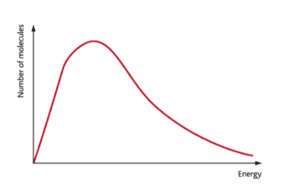
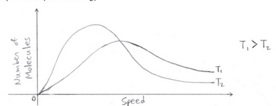

## The Maxwell Boltzmann Distribution

* The internal energy is randomly distributed across all the molecules according to the **Maxwell-Boltzmann distribution.**

 

* The Maxwell-Boltzmann distribution plots the kinetic energy against the number of molecules with that energy.
* The area under the graph represents the total number of gas molecules
* There are no molecules with zero energy, and only a few molecules have high-energy
* There is no maximum value of energy that a molecule can possess
* Note that the graph can change as temperature changes
* For example, when temperature increases, the graph's peak shifts to the right, so more molecules with higher speed and higher energy will increase. The average kinetic energy of the molecules increases.

