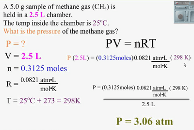

## Ideal Gas Equation

* Assuming an ideal gas, we can combine the three gas laws to produce a single equation relating the pressure, volume, temperature, and amount of gas:

$$

pV = NkT

$$

* N is the number of gas molecules, and k is the Boltzmann constant.
* The temperature must be the absolute temperature in Kelvin.
* This is known as the equation of state for an ideal gas, expressed in terms of the number of molecules present.
* To make this more useful in practice, where we are dealing with very large numbers of molecules, we replace the Boltzmann constant and the number N to obtain:

$$

pV = nRT

$$

* Where n is the number of moles of the gas; R is the Universal gas constant, R = 8.31 $J kg^{-1} mol^{-1}$

**Example of Calculation:**

