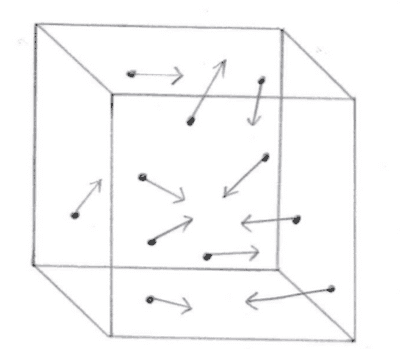
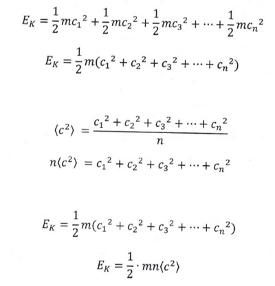

## Root-Mean-Square Speed (RMS Speed)

* The container contains n number of molecules that move randomly in different directions at a wide range of speeds. Since the container has many gas molecules, their average velocity is zero.

  

**Average speed** 

$$

c\\_{Avg} = \frac{c\\_1 + c\\_2 + c\\_3 + ... {c\\_n}}{n}

$$

**Mean-square speed**

$$

(c)^2 = \frac{c\\_1^2 + c\\_2^2 + c\\_3^2 + ... {c\\_n}^2}{n}

$$

**Root-mean-square**

$$

\sqrt{(c)^2} = \sqrt\frac{c\\_1^2 + c\\_2^2 + c\\_3^2 + ... {c\\_n}^2}{n}

$$

* RMS speed has a non-zero magnitude. lt is considered to be the average speed of the gas molecules in a sample. So, the total kinetic energy of gas the gas molecules in a sample is

* The average kinetic energy depends on the mean square speed, which is proportional to the gas's absolute temperature.

$$

E\\_{Kavg} \propto T

$$

$$

E\\_{Kavg} = kT

$$