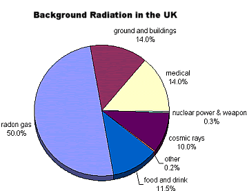

# Nuclear Decay

## Background Radiation

* **Background Radiation** refers to low levels of radiation always present in the environment, mainly from natural sources.
* Radiation is measured in counts per second in a unit called **Becquerel (Bq)**

 

**Sources of Background Radiation:**

* Radioactive gases (mainly radon) emitted from the ground can be trapped in buildings and build up to potentially dangerous levels – high levels of radon can greatly increase the risk of lung cancer.
* Radioactive elements in the Earth’s crust – mainly uranium and the isotopes it forms when it decays – give rise to gamma radiation, which is emitted from the ground and rocks and building materials.
* Cosmic rays from outer space bombard the Earth’s atmosphere, producing showers of lower-energy particles such as muons, neutrons, and electrons as gamma rays.
* Naturally occurring radioactive isotopes are present in our food and drink and in the air we breathe, including carbon-14 and potassium-40.
* Background radiation also comes from artificial sources such as medical sources.
* Due to the presence of background radiation, GM counters give small readings even though the source is not placed in front of the tube.

  This is called the background count rate.
* For any radioactive decay experiment, we have to note the background count rate at the beginning of the experiment. If the source is placed in front of the GM tube, the count rate changes, but background radiation cannot be eliminated.
* The reading that is given by the counter is contributed by the source and the background radiation. To get the actual reading of the source, we have to subtract the background count rate from the total reading.

**How does this affect humans?**

* Humans are generally capable of surviving such small doses of background radiation
* The exact exposure to nuclear radiation of an individual depends on where they are and how long they are there. For example, if you were in Ramsar in Iran, the background radiation would be 200 times more than the global average
* On Earth, approximately half the background radiation is from naturally radioactive gases which are in the atmosphere, particularly Radon

**Calculations:**

* Using a GM tube connected to a counting machine, we can determine the activity of the radioactive decay
* Since it is a spontaneous and random process, you will need to measure the counts over a long period of time, such as 30 minutes, and then divide the total number of counts by the number of seconds.
* The average count is about 0.5Bq, so when checking your answers, always compare the value obtained to this figure. If your answer is very far away from this value, you might want to double-check your work!

