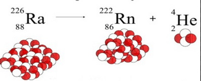
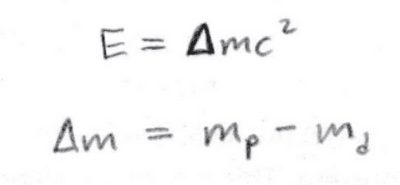
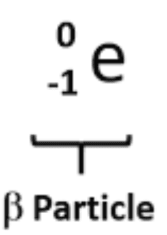
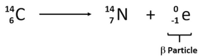
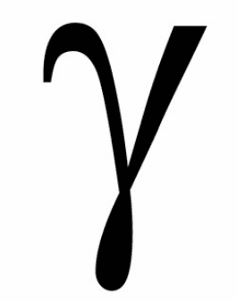
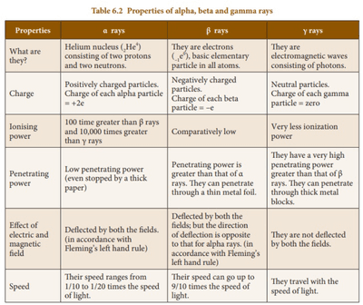
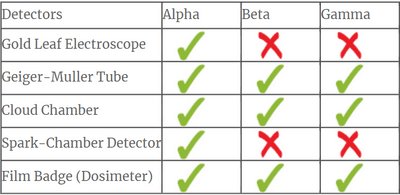

## Types of Nuclear Radiation

* First of all, let us tackle this question: Why does nuclear radiation occur?
* Most stable nuclei have equal numbers of protons and neutrons. This implies that two neutrons and two protons (an alpha particle) are the most stable composition for a nucleus.
* But, when more protons and neutrons are added, nuclei move to higher energy levels and become unstable again. To achieve stability once again, the nuclei try to return to their lower energy levels. Such nuclei undergo break-down, emitting radiation. You should also know that when a nuclear decay occurs, the radiation particle emitted will leave the nucleus with a certain amount of kinetic energy. As the particle travels, it will ionise particles in its path, losing a small amount of that kinetic energy at each ionisation. When all the kinetic energy is transferred, the radiation particle stops and is absorbed by the substance it is in that moment.
* The types of radioactive decay are alpha decay, beta decay, and decay by emitting gamma radiation.

### **Alpha Decay**

* Alpha (α) particles are high-energy particles that consist of 2 protons and 2 nucleons. Basically, a Helium nucleus

* They are emitted from large nuclei that want to achieve stability

* They have a significant positive charge of $+2e$, so they are highly ionising

* But because they ionise so much, this also means that they lose their kinetic energy relatively quickly and are easily absorbed

* They can be blocked by paper or skin, meaning that they have a low penetrating power

* Example of Alpha decay:

* Make sure that when you balance the equations, the sum of the mass numbers on the left = to those on the right, and the sum of atomic numbers on the left = those on the right.

* During alpha decay, the total number of protons and neutrons remains the same before and after the decay. However, the mass of the parent nucleus is greater than the sum of the masses of the daughter and helium (alpha) nuclei. This change in mass is converted to energy, according to Einstein's equation of mass-energy equivalence.

### **Beta Decay**

* Beta ($β^-$) Particles are high-energy electrons emitted from nuclei that have too many neutrons.

* They travel faster than alpha particles because they have a smaller mass.

* With its single negative charge and much smaller size, the beta particle is much less ionising than an alpha particle and thus penetrates much further. Several metres of air, or a thin sheet of aluminium, are needed to absorb beta particles.

* Relating this to Unit 4, you have seen Beta decays in this syllabus before in Topic 7C. Beta particles are known to be emitted with a range of kinetic energies and they experience the weak force, the force which allows quarks to change flavours

**Example of Beta Decay:**

### **Gamma Radiation**

* Gamma radiation is a high-frequency electromagnetic wave. it does not contain any conventional particles; it consists of photons.

* It is neutrally charged, and thus, it has minimum ionizing power. However, it has maximum penetrating power.

* The intensity of lts can be reduced by thick lead blocks. During gamma radiation emission, the parent nucleus remains unchanged.

* Gamma rays are never completely absorbed, but as long as their energy drops to a safe level, we consider them to be absorbed.

* This radiation is emitted when a high-energy nucleus returns to its low-energy level without changing its internal structure.

* The speed of gamma radiation is the same as the speed of light because they both are electromagnetic waves.

* Gamma radiation is not deflected by electric or magnetic fields because it does not consist of any charged particles.

### **Summary**

###   

### **Detecting Radiation**

