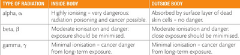

## Dangers of Nuclear Radiation

##  

* Learn this table because it is important for you to know the risks of each radiation.
* Ionising radiations can interact with the particles which make up human cells. There may be so much ionisation that the cells die as a result. Where there is less ionisation, the molecules of DNA in the cells may change slightly. These DNA mutations can cause cells to have an increased tendency to become cancerous. As the different types of nuclear radiation ionise to different extents, the hazard to humans is different for each type.
* Theoretically, it would be safe for us to hold an alpha particle in our hands. But we do not do that because it may transfer from our hands to our mouths and thus enter the body.