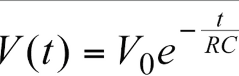
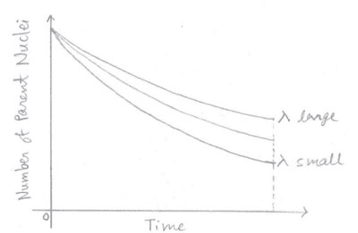

## The Spontaneous and Random Nature of Nuclear Decay

* Spontaneous decay means that we cannot influence when the nucleus will decay.
* Random decay means that we cannot predict when the nucleus will decay. We can only predict the fraction of a sample that will decay in a certain time.
* When observing the count rate using a GM Tube, we observe that the counts decrease at an irregular rate.
* Thus, radioactive decay is defined as The spontaneous disintegration of a nucleus to form a more stable nucleus, resulting in the emission of an alpha, beta or gamma particle.
* **Radioactive decay cannot be influenced by environmental factors such as**
  * Temperature
  * Pressure
  * Chemical Conditions

### **Decay Constant**

* Each nuclei will have an average decay rate

* Thus, we can assign them a decay constant, which is the probability that a nucleus will decay. The symbol denotes it $\lambda$

* Naturally, if the sample is larger, then the number that decays in a second will be greater. So the number decaying per second, called the activity A, is proportional to the number of nuclei in the sample, N. Mathematically, this is expressed as:

$$

A = N\lambda

$$

$$

\frac{dN}{dt} = - N\lambda

$$

* The minus sign in the formula occurs because the number of nuclei in the sample, N, decreases with time.

### **Exponential Decays**

* In recalling Topic 6B about capacitors, you learned a formula that represented exponential decay. It looked a little something like this:

  

* Now we are learning a similar formula, but related to radioactive decay

$N = N\\_0 e^{-\lambda t}$

$N\\_0$ is the initial number of undecayed nuclei

$\lambda$ is the decay constant

$t$ is the time interval

* This equation can be converted into its logarithmic form:

  $lnN = -\lambda t + ln N\\_0$

  Using this equation, we can compare it to $Y=mX+C$ and plot a straight-line graph

  $Y = lnN$

  $m = t$

  $X = -\lambda$

  $C = ln N\\_0$

  Thus, the gradient of the graph = $-\lambda$

  Using the value of λ obtained, we can calculate the half-life. This will be further explained in the next part titled “half-life”

* Since $A = -N\lambda$, the gradient of the graph gives the activity of the source at a particular instant. Since the activity of the source is proportional to the number of parent nuclei, it will always decrease with time.

* And as we know:

  $A = -N\lambda$

  $A = \lambda N\\_0 e^{-\lambda t}$

  $A = A\\_0 e^{-\lambda t}$