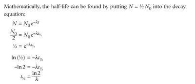
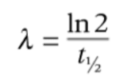

## Half-Life

* The activity of a radioactive sample decreases over time as the radioactive nuclei decay.
* While the activity of a sample depends on the nuclei present, the rate at which the activity decreases depends only on the particular isotope.
* A measure of this rate of decrease in activity is the half-life. This is the time taken for half of the atoms of that nuclide within a sample to decay.

Therefore, we get an important formula that helps us to determine the decay constant:

