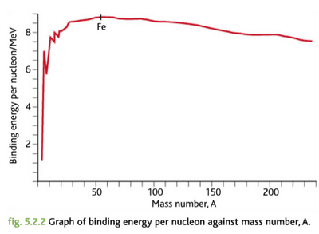

## Graph of Binding Energy per Nucleon against Mass Number, A

 

* The graph shows us that small nuclides can combine together to make larger nuclei (up to Fe-56) with a greater binding energy per nucleon. This process is called nuclear fusion. Similarly, larger nuclei can break up into smaller pieces, which have a greater binding energy per nucleon. Reactions like this are called nuclear fission.
* Helium-4, carbon-12 and oxygen-16 have a more stable nucleus, so you may notice some spikes in the graph that seem like anomalies at those mass numbers. This is because a stable nucleus means a higher binding energy per nucleon.
* You will be required to draw a best fit curve sometimes in the exam, so remember to include the anomaly that is Helium.

