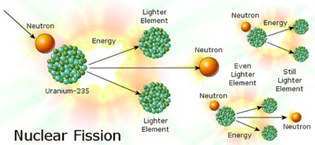
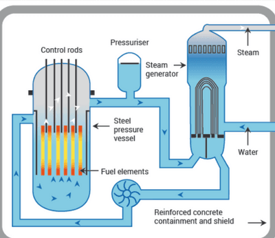

## Nuclear Fission

* The process where large nuclei split into small nuclei when Uranium-235 absorbs a slow-moving neutron

* Chain reactions occur in a nuclear reactor.

* The fission of atoms produces energy, which can be used to generate electricity.

* In a nuclear fission reactor, a moderator is used to control the chain reaction in such a way that in each fission reaction, one of the generated neutrons participates in the following reaction. It is called a critical condition.

* Control rods control the reaction by absorbing slow-moving neutrons.

* Fuel rods are also needed to initiate and carry out the reaction. Fuel rods contain Uranium.