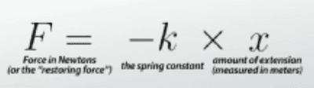

# Oscillations

## Simple Harmonic Motion

* To oscillate means to undertake continuously repeated movements
* Previously in unit 1, we learnt about Hooke’s Law, which states $F = kx$
* Now, we are introduced to a similar formula, $F = -kx$

**Simple Harmonic Motion (SHM)**: the oscillation of a system in which a force continually tries to return the object to its centre position, and this force is proportional to the displacement from that centre position.

* The force that returns the object to equilibrium is called the **restoring force**

**The 2 conditions for SHM to occur are:**

* The applied force of the acceleration is directly proportional to the extension

$$

F \propto x

$$

* The restoring force of acceleration is in the opposite direction of the extension or the displacement.

This is why there is a negative sign in the formula

**These two conditions can also be shown by:**

$F = - kx$

$F= ma$

$kx = ma$

$a= \frac{-kx}{m}$

$Thus, a \propto  -x$

The acceleration can also be written as $a = -ω^2x$. We will explore this in the next sections.

**Examples of Simple Harmonic Motion**

* Clock pendulum
* Mass on Spring
* Guitar string
* Electrons in an alternating current flowing through a wire