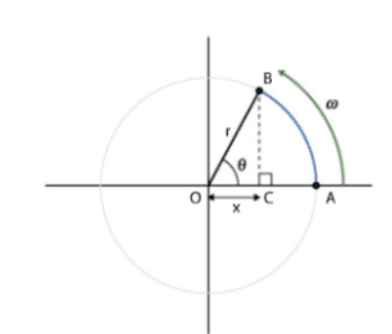

## SHM Mathematics

How does SHM relate to Topic 5B when learning about circular motion?

* Why is $\omega = 2\pi f$ ?
* Well, since we know that period, $T = \frac{1}{f} = \frac{2\pi }{\omega}$
* Thus, we can conclude that $\omega = 2\pi f$

* $x$ is the horizontal distance from the centre. The motion is a projection of a circular motion, so the equations for angular velocity, displacement, frequency and time are equally valid for simple harmonic motion. When the object is at position A, this projected distance $x$ is equal to the circle's radius, $r$, but at position B, this distance is shown by OC. This distance can be calculated from:

$x = rcos\theta$

Since $\omega = \frac{\theta}{t}$

So $x = rcos(\omega t)$

* In the case of a pendulum bob, the radius, $r$ should be replaced by its amplitude, $A$, of the pendulum’s swing.
* Alternatively, if a spring is used, $r$ is replaced with $A$, which denotes the displacement. The equation for SHM is then:

$$

F = -kAcos(\omega t)

$$

### **Displacement, Velocity and Acceleration Equations can be derived from this Equation**

$a = Acos(\omega t)$

$\frac{dx}{dt}$ = velocity $(v)$ and $\frac{d^2 x}{dt^2}$= acceleration $(a)$

$v = -A\omega sin(\omega t)$

$a = -A\omega ^2cos(\omega t)$