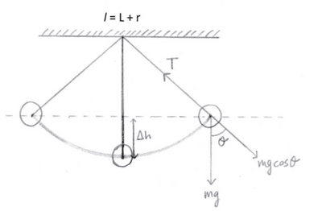

## Deriving Equations for a Simple Harmonic Oscillator and Simple Pendulum

### **Deriving Equations for a SHM**

* Firstly, we start off with the formula for restoring force, $F = -kx$
* We also need the formula for acceleration, $a = -\omega^2x$ . Rearrange this equation to get $\omega^2 = \frac{-a}{x}$
* Equate the formula $F = ma$ with $F = -kx$

$ma = -kx$

$a = \frac{-kx}{m}$

**Equate this with the acceleration formula**

$\frac{-kx}{m} = -\omega^2x$

**We can further simplify this to:**

$\frac{k}{m} = \omega^2$

Knowing that $\omega = \frac{2\pi}{T}$, we can equate these two equations, giving:

$\sqrt{\frac{k}{m}} = \frac{2\pi}{T}$

By squaring both sides and making T the subject, we get the final equation:

$$

T = 2\pi \sqrt {\frac{m}{k}}

$$

### **Deriving Equations for a Simple Pendulum**

* A simple pendulum is constructed by a freely suspended load from a rigid point. The distance between the point of suspension and the load's centre of gravity is called the length of the pendulum. So, we can say:

* Assuming that the angle $\theta$ is a small angle, we can carry out small angle approximations, $sin\theta = \theta$

  $F = ma$

  $ma = mgsin\theta$

  $a = g\theta$

  $x = r\theta$

  $\theta = \frac{x}{r}$

  Where $r$  = length of the pendulum, $l$

  $a = -g\frac{x}{l}$

  Thus, $a = -\frac{gx}{l}$

* Since it executes simple harmonic motion,

  $a = -\omega^2x$

  $-\omega^2x = -\frac{gx}{l}$

  Simplifying this, we get:

  $\omega^2 = \frac{g}{l}$

  Then, square root this equation:

  $\omega = \sqrt{\frac{g}{l}}$

  $\omega = 2\pi f$

  Equate both these equations:

  $2\pi f = \sqrt{\frac{g}{l}}$

  $f = \frac{1}{2\pi }\sqrt{\frac{g}{l}}$

  $T = \frac{1}{f}$

$$

T = 2\pi \sqrt{\frac{l}{g}}

$$